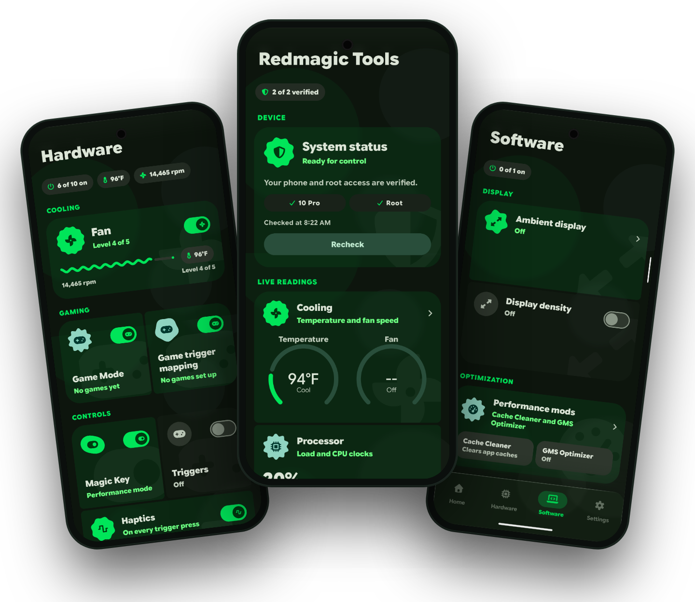

# Redmagic Tools

Root hardware and system control for the **RedMagic 10 Pro (NX789J)** on **Evolution X**.

Controls the fan, LEDs, shoulder triggers, Magic Key and haptics through the phone's sysfs and
`/proc` nodes as root.

  

## Before you start

The app writes to hardware nodes as root and is tested on one phone, the RedMagic 10 Pro. Uninstalling does not undo system changes. Turn those off in the app first.

## Features

### Home

- **System status**: checks for a RedMagic 10 Pro and root access.
- **Temperature and fan**: live dials. The fan dial shows the level, since the phone reports no
  maximum RPM.
- **Processor**: load, a graph of recent readings, and each CPU cluster's clock.
- **Memory**: RAM and swap.

### Hardware

- **Fan**: speed 0–5, Quiet / Balanced / Turbo curves, temperature control, on in games, on while fast charging.
- **Magic Key**: slider actions such as camera, Game Space, sound mode, flashlight, recorder, Performance mode or an app.
- **Triggers**: shoulder triggers as media and volume keys, with an optional tap-to-unlock.
- **Game trigger mapping**: per-game L/R touch targets for portrait and landscape, with single touch, long press, rapid fire and drag aim. Uses root touch, so it works on custom ROMs.
- **Haptics**: trigger feedback strength.
- **Fan LED / Logo LED**: colours and animations, previewed live.
- **Game Mode**: fan and LED settings applied while a chosen game is open.
- **Call lighting**: LEDs for incoming and connected calls; can pause the fan.
- **Charging mode**: fan and LED behaviour while plugged in.
- **Performance mode**: Balanced, Performance, Extreme and Ultra, with a battery heat guard.
- **Charge separation**: runs the phone from the charger with the battery idle, in games or always.

### Software

- **Ambient display**: tap to show, lift to show, and an always-on display schedule.
- **Display density**: change screen density; reverts unless you confirm.
- **Performance mods**: Cache Cleaner and GMS Optimizer.

### Settings

Theme, dynamic or custom colour, pure black, motion, edge blur, docked or floating navigation bar,
the liquid-glass bar and its playground, card blur, connected cards, coloured cards, background
animations, °C/°F, diagnostics and refresh intervals.

## Credits

- **[austineyoung2000/Redmagic-Control-Center](https://github.com/austineyoung2000/Redmagic-Control-Center)**: the original project this grew from.
- **[austineyoung2000/Redmagic-11-Toolbox](https://github.com/austineyoung2000/Redmagic-11-Toolbox)**: game trigger mapping profiles and their storage format.
- **[devnotcc/android_device_nubia_nx789j](https://github.com/devnotcc/android_device_nubia_nx789j/tree/bka/NubiaParts)**: performance profiles, ambient display, charge separation and cooling policies (Apache 2.0; licence and notice ship in the APK).
- **[RohitKushvaha01/TaskManager](https://github.com/RohitKushvaha01/TaskManager)**: processor and memory readings.
- **[sameerasw/essentials](https://github.com/sameerasw/essentials)**: edge blur and the floating back bar.
- **[Rouyashiki/YukiSU](https://github.com/Rouyashiki/YukiSU)**: motion intensity presets.
- **[khanhnguyen9872/NubiaToolkit](https://github.com/khanhnguyen9872/NubiaToolkit)**: hardware node reference.
- **[MorpheApp/morphe-manager](https://github.com/MorpheApp/morphe-manager) · [alesimula/Murine-launcher](https://github.com/alesimula/Murine-launcher) · [NPatch](https://github.com/7723mod/NPatch)**: UI patterns, background animations and the glass bottom bar.
- **[Font Awesome Free](https://github.com/FortAwesome/Font-Awesome)**: icons (CC BY 4.0, font SIL OFL 1.1; licence ships in the APK).
